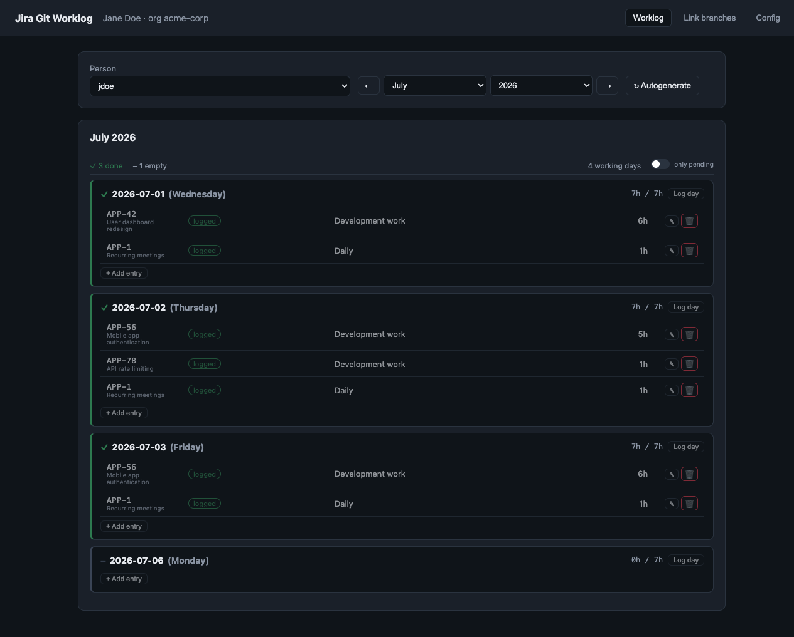
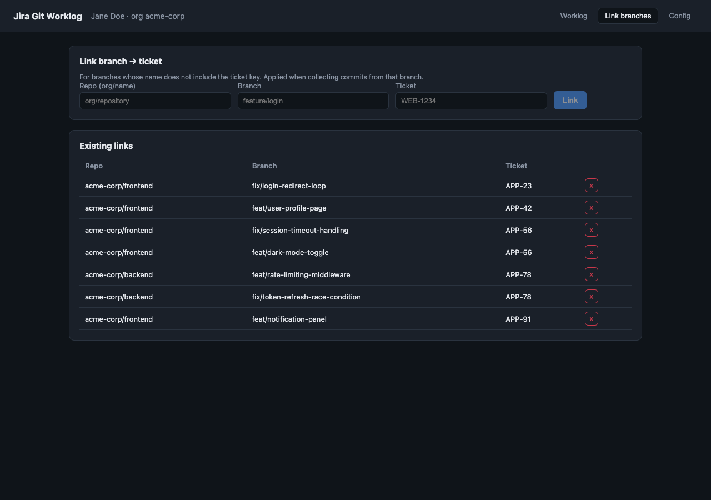
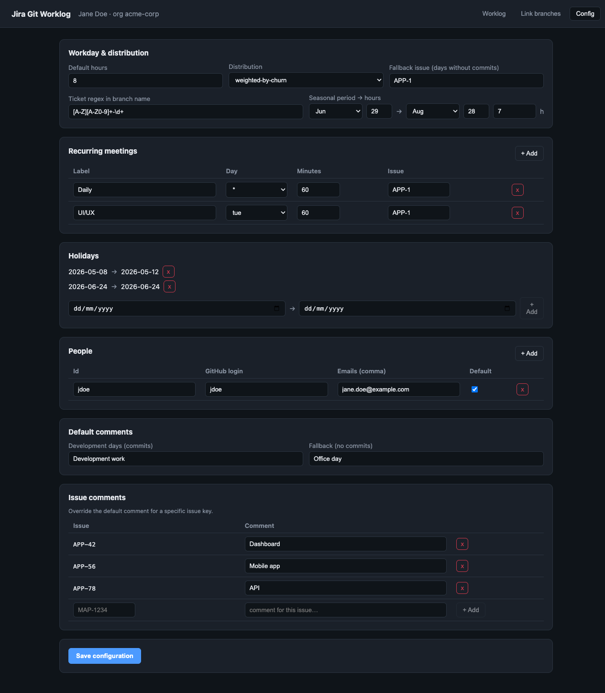

# jira-git-worklog

Automatically log time in **Jira** by reconstructing your day from **GitHub commits**.

---

## Who is this for?

This tool is for developers who tick all three boxes:

1. **Use GitHub** — branches are named with a Jira ticket key (e.g. `feature/WEB-1234-login`, `fix/PROJ-42-crash`).
2. **Use Jira Cloud** — and are required to log worked hours as **Jira worklogs** on each ticket.
3. **Don't track time in real-time** — no Toggl, no Clockify. You reconstruct what you did from your commits at the end of the day (or week).

If that's you, this tool eliminates the manual Jira time-logging entirely.

---

## How it works

```
GitHub commits
      │
      ▼
  detect ticket key          ← branch name regex or manual link
      │
      ▼
  distribute workday hours   ← weighted by lines changed, commits, or equally
      │
      ▼
  add recurring entries      ← daily standup, weekly meetings, etc.
      │
      ▼
  preview & edit in the UI   ← adjust hours, swap tickets, remove rows
      │
      ▼
  POST worklogs to Jira      ← idempotent, won't duplicate
```

Each person runs the app **locally** with their own Jira API token. Worklogs are created under the token owner's account — Jira's REST API does not allow logging on behalf of someone else without OAuth 3LO.

---

## Screenshots

**Worklog view** — review logged days with per-ticket breakdown and hours:



**Link branches** — manually map branches that don't follow the ticket-key convention:



**Config** — manage workday rules, recurring meetings, holidays, and people:



---

## Features

- **Ticket detection** from branch names via configurable regex (default: `[A-Z][A-Z0-9]+-\d+`).
- **Manual branch → ticket links** for branches that don't follow the naming convention.
- **Three distribution strategies**: `weighted-by-churn` (lines changed), `weighted-by-commits`, `equal`.
- **Recurring entries**: fixed blocks (standup, UI/UX sync, etc.) logged to a specific ticket every day or on specific weekdays.
- **Seasonal workday hours**: define shorter days for summer or other periods.
- **Holidays**: skip specific date ranges.
- **Factorial time off** (optional): your leaves and your office's company holidays shrink or cancel each day's workday, and nothing can be logged on a day off. See [Factorial time off](#factorial-time-off-optional).
- **Fallback issue**: catch-all ticket for workdays with no commits.
- **Preview UI**: inspect and edit the generated plan before submitting — change hours, reassign tickets, delete rows.
- **Idempotent**: each worklog carries a unique marker; re-running the same day won't create duplicates.
- **Multi-person**: configure multiple team members; the web UI lets you pick who you are.
- **Churn cache**: lines-changed data is cached by commit SHA to speed up repeated runs.

---

## Requirements

- **Node.js 20+**
- A **Jira Cloud** account with permission to log work on tickets.
- A **GitHub Personal Access Token** with access to your org's repositories.

---

## Quick start

```bash
# 1. Clone and install
git clone https://github.com/your-username/jira-git-worklog.git
cd jira-git-worklog
npm install

# 2. Set up secrets
cp .env.example .env
# → edit .env with your Jira URL, email, API token, GitHub token, and org

# 3. Set up workday rules
cp config.example.yaml config.yaml
# → edit config.yaml or use the Config tab in the web UI

# 4. Start
npm run dev
```

Open <http://127.0.0.1:5173>.

To verify your Jira credentials without starting the web UI:

```bash
npm run check:jira
```

---

## Configuration

`config.yaml` (excluded from git) holds your rules — no secrets, safe to share within a team:

```yaml
workday:
  defaultHours: 8
  seasonal:
    - from: "06-15"
      to: "09-15"
      hours: 7

recurring:
  - label: Daily standup
    weekday: "*"      # every workday; or mon/tue/wed/thu/fri
    minutes: 15
    issue: PROJ-1     # Jira ticket to log this against

fallbackIssue: PROJ-99   # logged on workdays with no commits (leave empty to skip)

distribution: weighted-by-churn   # or: equal, weighted-by-commits

ticketRegex: "[A-Z][A-Z0-9]+-\\d+"

factorial:
  enabled: false   # true = take time off from Factorial (needs FACTORIAL_API_KEY)

holidays:
  - from: 2025-12-24
    to: 2026-01-02

people:
  - id: alice
    githubLogin: alice
    emails:
      - alice@example.com
    default: true
```

Full field reference is in [SETUP.md](SETUP.md).

---

## Environment variables

| Variable | Description |
|---|---|
| `JIRA_BASE_URL` | Your Jira instance URL, e.g. `https://your-company.atlassian.net` |
| `JIRA_EMAIL` | Your Atlassian account email |
| `JIRA_API_TOKEN` | API token from [id.atlassian.com](https://id.atlassian.com/manage-profile/security/api-tokens) |
| `GITHUB_TOKEN` | Personal Access Token — classic with `repo` + `read:org`, or fine-grained with Contents:Read + Metadata:Read |
| `GITHUB_ORG` | GitHub organization or username that owns the repositories |
| `FACTORIAL_API_KEY` | Optional. Factorial API key, only needed when `factorial.enabled` is `true` |
| `PORT` | API server port (default: `4000`) |
| `CONFIG_PATH` | Path to `config.yaml` (default: `./config.yaml`) |

---

## Factorial time off (optional)

Off by default: with `factorial.enabled: false` Factorial is never called and days off come only from `holidays` in `config.yaml`.

With `factorial.enabled: true` (also a toggle in the **Config** tab) and `FACTORIAL_API_KEY` set:

- **Who you are**: the selected person is matched to a Factorial employee by the `emails` in `config.yaml`. Only that employee's leaves and their office's company holidays are read.
- **Workday per day**: workday hours minus time off. A leave with hours takes those hours, a half day takes 4 h, anything else takes the whole day. The result is capped at the workday, so an 8 h leave on a 7 h day is a full day off.
- **Days off**: shown as holidays with the reason, with no "+ Add entry". Hours already logged in Jira on such a day raise a warning.
- **Leave status**: approved leaves count; rejected ones are ignored; pending ones leave the day as a working day and add a warning.
- **`holidays` still applies**: Factorial adds to the list in `config.yaml`, it does not replace it.
- **Server-side check**: when logging, the server asks Factorial again and skips every day that is fully off, even if the plan was edited in the browser.
- **If Factorial is unreachable**: the preview is still generated, with a notice and without time off; logging is refused and nothing is sent to Jira.

---

## Known limitations

- **Authorship**: worklogs are created under the Jira token owner. Logging on behalf of a teammate requires OAuth 3LO, which this tool does not implement.
- **Branch scanning**: commits are found by scanning org branches, not GitHub's global commit search (which only indexes the default branch).
- **GitHub rate limits**: the first run on a large organization can be slow. Subsequent runs are faster thanks to the churn cache.
- **Factorial, partly-off days**: on a day with partial time off the reduced workday drives the plan, but the server does not reject logging more hours than that window.
- **Factorial API key scope**: an API key is company-wide. The app only requests the matched employee's leaves and their office's holidays.
- **Local data**: branch links, churn cache, and imputation ledger live in `server/data/store.json`, which is git-ignored.
